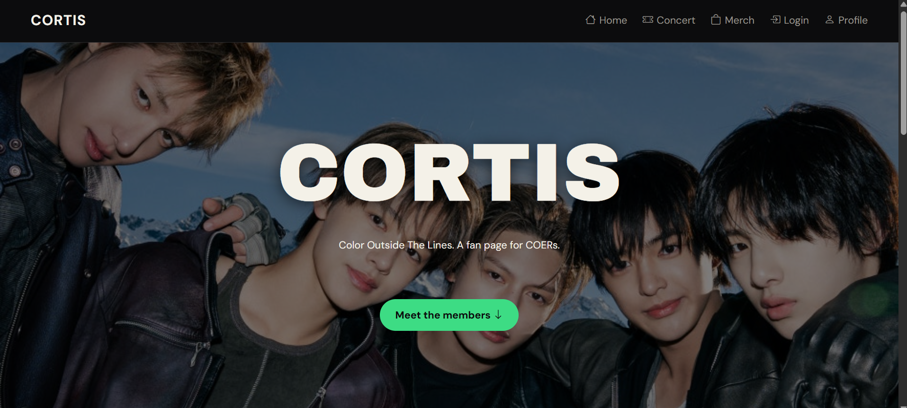

# CORTIS Fan Page

A fan page dedicated to CORTIS, built with plain HTML and CSS as a mini project for the Front End Basic Study Club (KSM Veterantech UPNVJ 2026).

**Live demo:** [https://cortis-coer-page.vercel.app/]



## About
This website introduces CORTIS: the members, the discography, merch info, and a short profile of the person who made it. It is a fan-made project and is not affiliated with CORTIS or BIGHIT MUSIC.

## Pages

| Page | File | What it contains |
|---|---|---|
| Home | `index.html` | Hero, members, discography table, album cards |
| Profile | `profile.html` | About the creator, interests and skills, contact |
| Login | `login.html` | Login form (display only, no data is sent) |
| Merch | `merch.html` | [Merch guide, if finished] |

## Concepts Applied

- Semantic HTML (`header`, `nav`, `main`, `section`, `footer`)
- Text, lists, tables, media, links, and forms
- Intra-page links, external links, and email link
- Box Model, Position (sticky navbar, absolute overlays)
- Selectors, pseudo-classes, and pseudo-elements
- Flexbox and CSS Grid

## Folder Structure

```
cortis-fan-page/
├── index.html
├── profile.html
├── login.html
├── merch.html
├── README.md
├── css/
│   ├── style.css
│   └── login.css
├── images/
└── screenshots/
```

## How to Run

1. Clone the repository:
```
   git clone https://github.com/Salsaaax/cortis-fan-page.git
```
2. Open the folder in VS Code.
3. Open `index.html` in your browser (or use the Live Server extension).

No installation or build step is needed.

## Author
**Armellia Salsabilla**
Informatics, UPN Veteran Jakarta
GitHub: [@Salsaaax](https://github.com/Salsaaax)